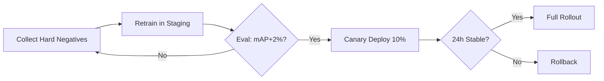

# 📋 Runbook: Isfahan Smart Intersection Pilot (ISIP)
**عملیات استقرار و مدیریت سیستم مدیریت هوشمند ترافیک تقاطع چهارباغ-آزادی**

---

## 🎯 هدف
استقرار کامل سیستم در تقاطع چهارباغ-آزادی اصفهان با uptime 99.5% و تأخیر پردازش < 50ms

---

## 📦 پیش‌نیازهای سخت‌افزاری

| تجهیز | تعداد | مشخصات | مکان نصب |
|---------|-------|----------|----------|
| **Jetson Orin AGX 64GB** | ۲ (Active + Hot Standby) | JetPack 6.0, TensorRT 10 | کابینेट کنترل تقاطع |
| **دوربین IP 4K PoE** | ۸ | 25 FPS, H.265, IR, IP67 | ۴ روی يأتي + ۴ نمای غoghi |
| **Switch Industrial 10G** | ۱ | Managed, PoE+, Redundant PSU | کابینت کنترل |
| **UPS آنلاین** | ۱ | ۳۰ دقیقه بک‌آپ، SNMP | کابینت کنترل |
| **مبدل فایبر-میدیا** | ۲ | Single-mode, 10km | اتصال به شبکه شهرداری |

---

## 🔧 مراحل استقرار (Deployment Checklist)

### Phase 0: آماده‌سازی زیرساخت (Week -1)
- [ ] ثبت IPهای ثابت برای Jetsonها و دوربین‌ها در DHCP reservas
- [ ] کانفیگ VLAN ترافیک (VLAN 100) روی سوئیچ‌های شهرداری
- [ ] نصب گواهی‌های TLS (CA، Client Cert) در `/certs/` روی Jetsonها
- [ ] تست اتصال MQTT به بروکر UTC (پورت 8883، TLS mutual auth)
- [ ] تست دسترسی HTTPS به APIهای CMS/SCADA
- [ ] резерه کردن پورت‌های فایروال: 1883, 8883, 8000, 8001, 8080, 9090, 9091, 9100, 9400

### Phase 1: استقرار Edge (Day 1-2)
```bash
# روی هر Jetson Orin:
# 1. نصب JetPack 6.0 + NVIDIA Container Toolkit
sudo apt update && sudo apt install -y nvidia-container-toolkit
sudo nvidia-ctk runtime configure --runtime=docker
sudo systemctl restart docker

# 2. کلون ریپو و کپی فایل‌ها
git clone https://github.com/your-org/isfahan-smart-intersection.git
cd isfahan-smart-intersection

# 3. تنظیم Environment
cp .env.example .env
nano .env  # پر کردن: RTSP URLs، MQTT creds، Webhook URLs

# 4. کپی گواهی‌ها
mkdir -p certs
# کپی ca.crt, client.crt, client.key به certs/

# 5. Build Images
docker compose -f docker-compose.edge.yml build --parallel

# 6. Deploy
docker compose -f docker-compose.edge.yml up -d

# 7. Verify
docker compose -f docker-compose.edge.yml ps
docker compose -f docker-compose.edge.yml logs -f deepstream triton
curl http://localhost:9091/health
curl http://localhost:8000/v2/health/ready
```

### Phase 2: کالیبراسیون دوربین‌ها (Day 2-3)
```bash
# برای هر دوربین:
# 1. استخراج Intrinsic/Extrinsic
python tools/calibration/calibrate_camera.py \
  --rtsp rtsp://... \
  --checkerboard 9x6 \
  --output configs/calibration/cam_XX.yaml

# 2. Verify projection accuracy
python tools/calibration/verify_projection.py \
  --config configs/calibration/cam_XX.yaml \
  --test-image test_frames/cam_XX.jpg
```

### Phase 3: تست ادغام UTC/SCADA (Day 3-4)
```bash
# 1. تست دریافت دستورات سیگنال
mosquitto_sub -t 'isfahan/traffic/chaharbag_azadi/signal_commands' -v

# 2. تست ارسال ناهنجاری‌ها
mosquitto_sub -t 'isfahan/traffic/chaharbag_azadi/anomalies' -v

# 3. تست Heartbeat
mosquitto_sub -t 'isfahan/traffic/chaharbag_azadi/bridge/heartbeat' -v

# 4. Verify با اپراتورهای اتاق کنترل
# - چک کردن داشبورد گرافانا
# - تست سناریو What-if
```

### Phase 4: مانیتورینگ ۲ هفته (Week 1-2)
| روز | فعالیت | معیار پذیرش |
|-----|---------|-------------|
| 1-3 | مانیتورینگ ۲۴/۷ لاگ‌ها | Zero critical errors |
| 4-7 | مقایسه با شمارش دستی | Count accuracy > 95% |
| 8-10 | تست ناهنجاری‌های واقعی | F1 > 0.90 on real anomalies |
| 11-14 | تست کنترل تطبیقی سیگنال | 15%+ wait reduction vs fixed |

---

## 🚨 روال‌های حادثه (Incident Response)

### P0 - Critical (Immediate Response < 15 min)
| حادثه | علائم | اقدام فوری | эскаلشن |
|--------|--------|------------|---------|
| **GPU OOM / Driver Crash** | Deepstream restart loop، `nvidia-smi` fail | `docker restart isfahan-deepstream` → اگر تکرار شد: fallback به standby Jetson | تیم Hardware + NVIDIA Support |
| **MQTT Disconnect > 5 min** | Alert webhook fired، MQTT_CONNECTED=0 | چک شبکه، ریستارت mqtt-bridge، verify UTC broker | مدیر شبکه شهرداری |
| **Camera Feed Lost** | CAMERA_FPS=0، health=critical | چک PoE switch، ریستارت دوربین، کابل | تکنیشین میدانی |
| **Triton Model Load Fail** | Health endpoint 503، model not ready | `docker restart isfahan-triton`، چک model repo | ML Engineer |

### P1 - High (Response < 1 hour)
| حادثه | علائم | اقدام |
|--------|--------|---------|
| **Detection mAP Drop > 10%** | Grafana alert، validation metrics | Collect hard negatives، retrain YOLO |
| **Tracking ID Switches > 20%** | MOTA drop، fragmented tracks | Tune BoT-SORT thresholds، ReID fine-tune |
| **Anomaly False Positives > 15%** | Operator complaints، alert fatigue | Adjust confidence thresholds، add negative mining |

### P2 - Medium (Response < 4 hours)
- GPU thermal throttling (> 83°C)
- Disk usage > 80%
- Certificate expiry < 30 days

---

## 🔧 عملیات روزمره (Daily Operations)

### صبح (۰۷:۳۰ - ۰۸:۳۰) - پیش از اوج ترافیک
```bash
# 1. چک سلامت کلی
curl -s http://localhost:9091/health | jq '.status'

# 2. چک متریک‌های GPU
curl -s http://localhost:9400/metrics | grep -E 'gpu_(memory|temp|power)'

# 3. چک دوربین‌ها
curl -s http://localhost:9091/components | jq '.camera_* | select(.status != "healthy")'

# 4. چک очеред MQTT
mosquitto_sub -t 'isfahan/traffic/chaharbag_azadi/#' -C 10 -v | head -20

# 5. تست کنترل سیگنال (دستی)
mosquitto_pub -t 'isfahan/traffic/chaharbag_azadi/signal_commands' \
  -m '{"intersection_id":"chaharbag_azadi","plan_id":"morning_peak","priority":"normal"}'
```

### ظهر (۱۲:۰۰ - ۱۳:۰۰) - بین دو اوج
- جمع‌آوری آمار صبح
- چک فضای دیسک: `df -h /var/lib/docker`
- لاگ‌روتیشن چک: `docker exec isfahan-deepstream ls -lh /var/log/`

### عصر (۱۶:۳۰ - ۱۷:۳۰) - پیش از اوج عصر
- تکرار چک‌های صبح
- فعال‌سازی پروفایل `evening_peak` در RL agent
- تست What-if برای برنامه عصر

### شب (۲۲:۰۰) - پس از ترافیک
- بکاپ دیتابیس: `docker exec isfahan-clickhouse clickhouse-client --query "BACKUP DATABASE isfahan TO Disk('backups')" `
- بکاپ مدل‌ها: `tar -czf models_backup_$(date +%F).tar.gz models/`
- پاک‌سازی لاگ‌های قدیمی: `find /var/log -name "*.log" -mtime +30 -delete`

---

## 📊 داشبوردهای کلیدی (Grafana)

| داشبورد | URL |.refresh | مالک |
|----------|-----|----------|------|
| **Traffic Overview** | `/d/isfahan-chaharbag-azadi` | 10s | اپراتور اتاق کنترل |
| **Edge Health** | `/d/isfahan-edge-health` | 30s | DevOps |
| **Model Performance** | `/d/isfahan-model-perf` | 5m | ML Engineer |
| **Anomaly Analysis** | `/d/isfahan-anomalies` | 1m | Traffic Police Liaison |
| **Signal Control** | `/d/isfahan-signal-rl` | 10s | Traffic Engineer |

---

## 🗂️ مسیرهای مهم (Key Paths)

| محتوا | مسیر در کانتینر | مسیر روی Host |
|--------|-----------------|---------------|
| **Model Weights** | `/app/weights/` | `./models/*/weights/` |
| **Config Files** | `/app/configs/` | `./configs/` |
| **Logs (DeepStream)** | `/var/log/deepstream/` | Docker volume |
| **Triton Model Repo** | `/models/model_repo/` | `./edge/triton_model_repo/` |
| **Certificates** | `/certs/` | `./certs/` |
| **Prometheus Data** | `/prometheus/` | `prometheus-data` volume |
| **ClickHouse Data** | `/var/lib/clickhouse/` | `clickhouse-data` volume |

---

## 🔐 مدیریت گواهی‌ها (Certificate Management)

```bash
# چک انقضا
openssl x509 -in certs/client.crt -text -noout | grep "Not After"

# تمدید (۳۰ روز قبل)
# 1. درخواست ازPKI شهرداری
# 2. جایگزینی فایل‌ها در certs/
# 3. ریستارت سرویس‌های TLS-aware
docker compose -f docker-compose.edge.yml restart mqtt_bridge triton deepstream
```

---

## 📈 پروفایل‌های ترافیک (Traffic Profiles)

| پروفایل | ساعات | پارامترهای RL | فاز پیش‌فرض |
|----------|-------|---------------|-------------|
| **Morning Peak** | 07:00-09:30 | `traffic_density=1.0`, `pedestrian_weight=1.2` | Phase 0 (NB/SB) extended |
| **Midday** | 09:30-16:00 | `traffic_density=0.7`, `equity_weight=1.0` | Balanced |
| **Evening Peak** | 16:00-19:30 | `traffic_density=1.0`, `emergency_priority=2.0` | Phase 2 (EB/WB) extended |
| **Night** | 19:30-07:00 | `traffic_density=0.3`, `min_green_enforced=true` | Flashing yellow / All-red ped |
| **Friday** | All day | `traffic_density=0.8`, `pedestrian_weight=1.5` | Extended pedestrian |
| **Ramadan** | Shifted | `evening_peak_shift=+2h`, `pedestrian_weight=1.3` | Adjusted |
| **Special Events** | Custom | `event_mode=true`, `manual_override` | Operator controlled |

---

## 📞 لیست تماس اضطراری (Emergency Contacts)

| نقش | نام | تلفن | ایمیل | زمان پاسخگویی |
|------|-----|------|-------|--------------|
| **Tech Lead** | [نام] | ۰۹۱۲-xxx-xxxx | tech-lead@isfahan.ir | ۱۵ دقیقه |
| **DevOps Engineer** | [نام] | ۰۹۱۲-xxx-xxxx | devops@isfahan.ir | ۳۰ دقیقه |
| **ML Engineer** | [نام] | ۰۹۱۲-xxx-xxxx | ml@isfahan.ir | ۱ ساعت |
| **Network Admin (شهرداری)** | [نام] | ۰۳۱-xxx-xxxx | network@isfahan.municipality.ir | ۳۰ دقیقه |
| **UTC Operator** | اتاق کنترل | ۰۳۱-xxx-xxxx | utc@isfahan.municipality.ir | فوری |
| **Field Technician** | [نام] | ۰۹۱۲-xxx-xxxx | field@isfahan.ir | ۱ ساعت |
| **NVIDIA Enterprise Support** | - | ۱۸۰۰-xxx-xxxx | enterprise@nvidia.com | ۴ ساعت (SLA) |

---

## 📝 لاگ‌برداری و حسابرسی (Audit Trail)

### لاگ‌های حیاتی (Retention: 1 سال)
- **Signal Changes**: تمام تغییرات فاز سیگنال (auto + manual)
- **Anomaly Alerts**: تمام هشدارهای ناهنجاری با confidence و severity
- **Model Inferences**:サンプリング ۱٪ از استنتاج‌ها برای drift detection
- **Operator Actions**: کلیه اقدامات دستی در داشبورد

### فرمت لاگ (Structured JSON)
```json
{
  "timestamp": "2024-01-15T08:30:45.123Z",
  "event_type": "signal_change",
  "intersection": "chaharbag_azadi",
  "source": "rl_agent|operator|utc_override",
  "details": {
    "previous_phase": 0,
    "new_phase": 1,
    "phase_duration": 55,
    "reason": "pressure_based_extension"
  },
  "operator_id": null,
  "trace_id": "abc123..."
}
```

---

## 🔄 فرآیند به‌روزرسانی مدل (Model Update Process)



### گام‌های استقرار مدل جدید
```bash
# 1. Tagging در MLflow
mlflow models transition -m "yolov10-isfahan" -v 5 -s Staging -t Production

# 2. Pull image جدید (اگر containerized)
docker pull registry.isfahan.ir/isfahan-deepstream:v1.2.0

# 3. Canary Deploy (Blue/Green)
docker compose -f docker-compose.edge.yml up -d --scale deepstream=2 --no-recreate

# 4. Traffic Split (10% به نسخه جدید)
# Via nginx sidecar یا Triton model version policy

# 5. Monitor 24h
# - mAP on real-time validation set
# - Latency percentiles
# - Anomaly rate changes

# 6. Full Rollback/Rollout
docker compose -f docker-compose.edge.yml up -d --scale deepstream=1
```

---

## 📦 بکاپ و بازیابی (Backup & Restore)

| مورد | فرکانس | نگهداری | ابزار |
|------|--------|---------|-------|
| **ClickHouse DB** | روزانه ۰۲:۰۰ | ۹۰ روز | `clickhouse-backup` |
| **Model Registry** | هفتگی | ۱ سال | MLflow + MinIO versioning |
| **Configs** | در هر تغییر | همیشگی | Git (tagged releases) |
| **Grafana Dashboards** | روزانه | ۳۰ روز | Grafana API export |
| **Certificates** | قبل از انقضا | ۲ نسخه | Vault/SealedSecrets |

### تست بازیابی (Quarterly)
```bash
# 1. Restore ClickHouse to staging
clickhouse-backup restore 2024-01-15T02:00:00

# 2. Verify data integrity
clickhouse-client --query "SELECT count() FROM isfahan.detections WHERE date = today()"

# 3. Test model loading from MLflow
mlflow run models/detection -P version=latest

# 4. Document RTO/RPO
# RTO: 2 hours, RPO: 24 hours
```

---

## ✅ چک‌لیست نهایی تحویل (Handover Checklist)

### مستندات
- [ ] Architecture Decision Records (ADRs)
- [ ] API Specifications (OpenAPI/Swagger)
- [ ] Data Dictionary (ClickHouse schema)
- [ ] Runbook این فایل (نسخه چاپی + دیجیتال)
- [ ] Disaster Recovery Plan

### دسترسی‌ها
- [ ] SSH Keys برای Jetsonها
- [ ] Grafana Admin Credentials
- [ ] MLflow/MinIO Access Keys
- [ ] ClickHouse Read/Write Users
- [ ] VPN Access به شبکه شهرداری

### آموزش
- [ ] جلسه ۲ ساعته برای اپراتورهای اتاق کنترل
- [ ] جلسه ۱ ساعته برای تیم شبکه شهرداری
- [ ] مستندات عیب‌یابی رایج (Troubleshooting Guide)

### امضاها
| نقش | نام | امضا | تاریخ |
|------|-----|------|-------|
| Technical Lead | | | |
| Municipality IT Director | | | |
| Traffic Engineering Head | | | |
| Project Manager | | | |

---

*آخرین به‌روزرسانی: ۲۰۲۴-۰۱-۱۵ | نسخه: ۱.۰ | طبقه‌بندی: محرمانه - شهرداری اصفهان*